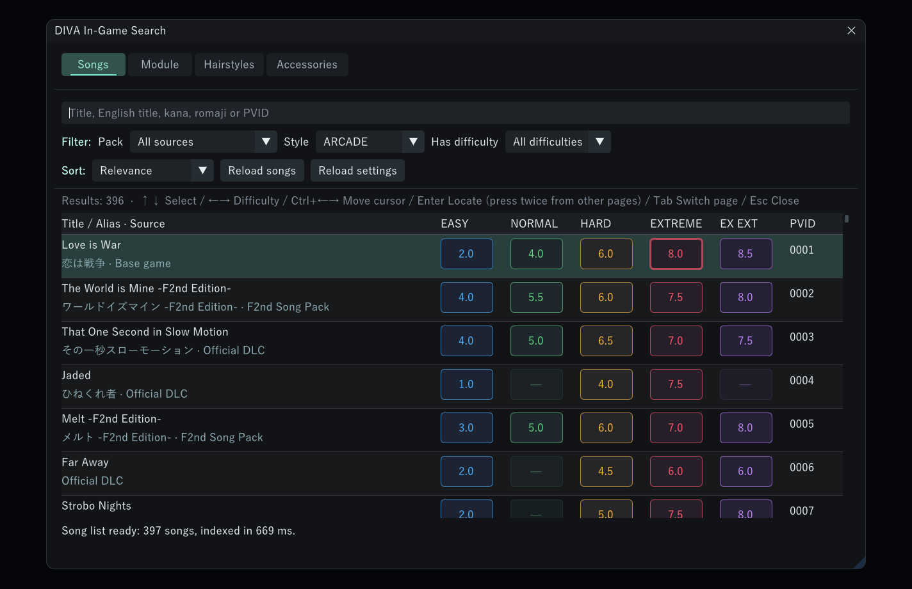
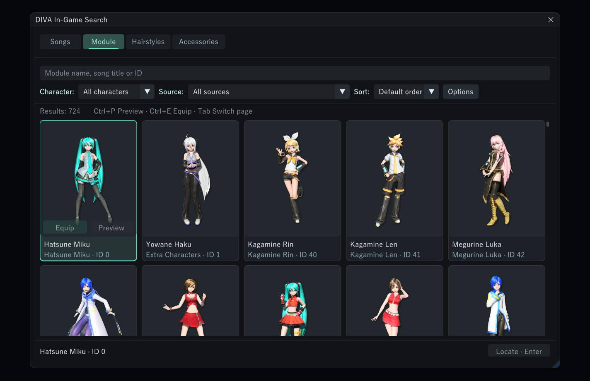

# DIVA In-Game Search

English · [简体中文](README.md)

A search mod for *Hatsune Miku: Project DIVA Mega Mix+*. Press **Ctrl+F** in-game to search songs, modules, hairstyles and accessories, then jump straight to what you picked.




## Installation

1. Install [DivaModLoader](https://github.com/blueskythlikesclouds/DivaModLoader).
2. Close the game and put the `DivaInGameSearch` folder from the [Releases](https://github.com/HYDlink/DivaInGameSearch/releases/latest) archive into your `mods` folder.
3. Enable it in your mod manager.

To update, close the game and overwrite the folder. Skip `settings.ini` if you want to keep your settings. To uninstall, delete the folder; your save data and other mods are not affected.

## What you can search

| Page | Search by | What you can do |
| --- | --- | --- |
| Songs | Original title, English title, kana, romaji, PVID; Chinese titles too with the [Chinese Lyrics Mod](https://gamebanana.com/mods/389814) | Filter and sort by song pack, style and difficulty; jump to a specific difficulty |
| Module | Module name or song title (shows that song's recommended modules) | Preview, equip |
| Hairstyles | Hairstyle name or song title | Preview, change |
| Accessories | Item name, grouped by body part | Preview, change |

You can only switch to items you already own. The mod never buys anything for you and never starts a song for you.



## Controls

| Key | Action |
| --- | --- |
| Ctrl+F | Open search; if already open, select all search text |
| Tab / Ctrl+Tab | Next / previous tab |
| ↑ ↓ ← → | Choose a result and difficulty |
| Ctrl+← → | Move the cursor in the search box |
| Enter or click | Locate on the current page |
| Double Enter or double-click | Jump there from another page |
| Ctrl+P / Ctrl+E | Preview / equip |
| Esc or click outside | Close |

The hotkey, font size, row height and opacity can be changed in `settings.ini`.

## Language

The interface is available in English, Japanese and Simplified Chinese. By default it follows the game's language: Chinese uses Simplified Chinese, Japanese uses Japanese, and anything else uses English. Module, hairstyle and accessory names use the same language. To choose one yourself, set `language` to `en`, `ja` or `zh-CN` in `settings.ini` and restart the game.

## Known issues

- Restart the game after adding or removing song packs; otherwise search results may not match what the game has loaded.
- Recommended-module inheritance for special swimsuits is not fully supported yet.
- After a jump, the cover or credits can briefly keep showing the previous song.

Please report problems in [Issues](https://github.com/HYDlink/DivaInGameSearch/issues) with steps to reproduce and your `search-diagnostics.log`. Remove any paths you don't want to share before posting. If keys stop working, see the [input troubleshooting guide](docs/INPUT_TROUBLESHOOTING.md) (Chinese). Tested coverage is listed in the [acceptance record](docs/ACCEPTANCE.md) (Chinese).

## Development

You need Windows x64, PowerShell 7, the Visual Studio C++ toolset, the Windows SDK and CMake 3.24+. Dependencies are included in the repository.

```powershell
./scripts/build.ps1
./scripts/verify.ps1 -GameDirectory 'your game folder'
./scripts/package.ps1
```

Start with [AGENTS.md](AGENTS.md) and the [developer guide](docs/IMPLEMENTATION_HANDOFF.md) (both Chinese). This project is developed by a human working with AI, and contributions are welcome.

## Credits

This project builds on public community research:

- **[QuantumSwitch](https://github.com/Snapmali/QuantumSwitch)**: song selection state, PVID targeting and menu switching. Thanks also to those it credits: **hiki8man (Select Song with PVID)** and **[sasnchis (DivaSongViewer)](https://github.com/sasnchis/DivaSongViewer)**.
- **[MikuMikuSwitchPlugin](https://github.com/lsmsmx/MikuMikuSwitchPlugin)**: the in-game search and list rebuild flow in `SongQuickJump`.
- **[NewClassics](https://github.com/mrcloverthecoder/nc)**, **[DivaModLoader](https://github.com/blueskythlikesclouds/DivaModLoader)**, **[ReDIVA](https://github.com/korenkonder/ReDIVA)**: song selection objects, plugin loading and data structures.
- [Dear ImGui](https://github.com/ocornut/imgui), [Microsoft Detours](https://github.com/microsoft/Detours), [toml++](https://github.com/marzer/tomlplusplus).

See [sources](docs/SOURCES.md), [third-party notices](THIRD_PARTY_NOTICES.md) and the [dependency lock](docs/DEPENDENCY_LOCK.md) for usage, versions and licenses.

## License

The code is released under **AGPL-3.0-or-later** (see [LICENSE](LICENSE)). Third-party components keep their own licenses. Rights to the game's name, songs and related content belong to their respective owners. This is not an official product.
