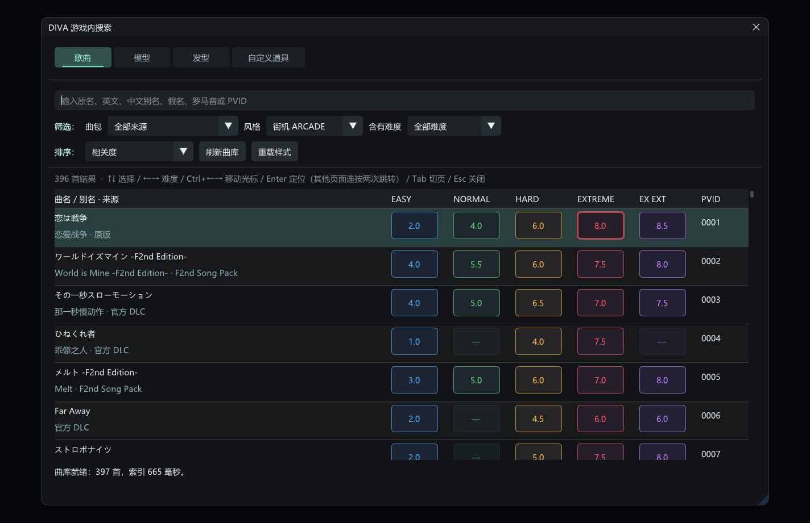
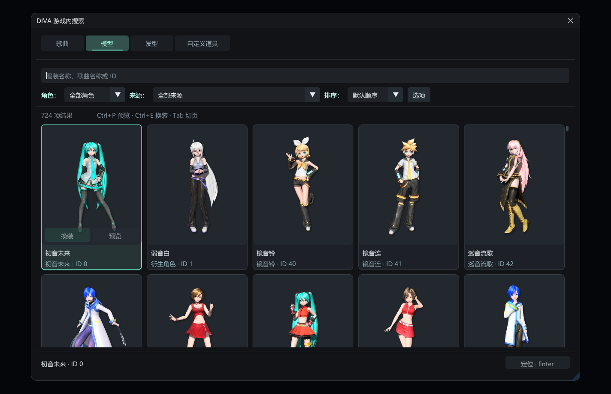

# DIVA 游戏内搜索

[English](README.en.md) · 简体中文

《初音未来 Project DIVA Mega Mix+》的搜索 Mod：在游戏里按 **Ctrl+F**，搜歌曲、服装、发型和道具，选中就跳过去。



## 安装

1. 装好 [DivaModLoader](https://github.com/blueskythlikesclouds/DivaModLoader)。
2. 退出游戏，把 [Releases](https://github.com/HYDlink/DivaInGameSearch/releases/latest) 压缩包里的 `DivaInGameSearch` 文件夹放进 `mods` 目录。
3. 用 Mod 管理器启用。

更新：同样退出游戏后覆盖。想保留设置就别覆盖 `settings.ini`。卸载：删掉这个文件夹，不影响存档和其他 Mod。

## 能搜什么

| 页面 | 怎么搜 | 能做什么 |
| --- | --- | --- |
| 歌曲 | 原名、英文、假名、罗马音、PVID；装了 [Chinese Lyrics Mod](https://gamebanana.com/mods/389814) 还能搜中文 | 按曲包、风格、难度筛选和排序，跳到指定难度 |
| 模型 | 服装名或歌名（显示这首歌的推荐服装） | 预览、换装 |
| 发型 | 发型名或歌名 | 预览、更换 |
| 自定义道具 | 道具名，按部位分类 | 预览、更换 |

只能更换已拥有的物品，不会替你购买，也不会替你开始演奏。



## 按键

| 按键 | 作用 |
| --- | --- |
| Ctrl+F | 打开搜索；已打开时全选搜索文字 |
| Tab / Ctrl+Tab | 切换顶部标签 / 回切 |
| ↑ ↓ ← → | 选择结果和难度 |
| Ctrl+← → | 在搜索框里移动光标 |
| Enter 或单击 | 在当前页定位 |
| 连按两次 Enter 或双击 | 从其他页跳过去 |
| Ctrl+P / Ctrl+E | 预览 / 换装 |
| Esc 或点窗口外 | 关闭 |

快捷键、字号、行高和透明度可以在 `settings.ini` 里改。

## 语言

界面支持简体中文、英文和日文，默认跟随 Windows 语言：中文用简中，日文用日文，其余用英文。服装、发型和道具名称使用同一语言。想手动指定，就把 `settings.ini` 里的 `language` 改成 `zh-CN`、`en` 或 `ja`，然后重启游戏。

## 已知问题

- 增删曲包后要重启游戏，否则搜索结果和游戏已加载的内容可能不一致。
- 特殊泳装的推荐继承还没有完整支持。
- 定位后，封面或作者信息偶尔会短暂停留在上一首。

遇到问题请到 [Issues](https://github.com/HYDlink/DivaInGameSearch/issues) 反馈，附上复现步骤和 `search-diagnostics.log`，发出前去掉不想公开的路径。按键失灵先看[排错指南](docs/INPUT_TROUBLESHOOTING.md)，已测范围见[验收记录](docs/ACCEPTANCE.md)。

## 开发

需要 Windows x64、PowerShell 7、Visual Studio C++ 工具集、Windows SDK 和 CMake 3.24+，依赖都在仓库里。

```powershell
./scripts/build.ps1
./scripts/verify.ps1 -GameDirectory '你的游戏目录'
./scripts/package.ps1
```

从 [AGENTS.md](AGENTS.md) 和[开发指南](docs/IMPLEMENTATION_HANDOFF.md)开始看。本项目由人和 AI 协作开发，欢迎参与。

## 致谢

本项目建立在社区公开的研究之上：

- **[QuantumSwitch](https://github.com/Snapmali/QuantumSwitch)**：选曲状态、PVID 定位和菜单切换；同时感谢其致谢的 **hiki8man（Select Song with PVID）** 和 **[sasnchis（DivaSongViewer）](https://github.com/sasnchis/DivaSongViewer)**。
- **[MikuMikuSwitchPlugin](https://github.com/lsmsmx/MikuMikuSwitchPlugin)**：`SongQuickJump` 的游戏内搜索和列表重建流程。
- **[NewClassics](https://github.com/mrcloverthecoder/nc)**、**[DivaModLoader](https://github.com/blueskythlikesclouds/DivaModLoader)**、**[ReDIVA](https://github.com/korenkonder/ReDIVA)**：选曲对象、插件加载和数据结构资料。
- [Dear ImGui](https://github.com/ocornut/imgui)、[Microsoft Detours](https://github.com/microsoft/Detours)、[toml++](https://github.com/marzer/tomlplusplus)。

用途、版本和许可见[资料来源](docs/SOURCES.md)、[第三方声明](THIRD_PARTY_NOTICES.md)和[依赖锁定](docs/DEPENDENCY_LOCK.md)。

## 许可证

代码以 **AGPL-3.0-or-later** 发布，见 [LICENSE](LICENSE)，第三方组件保留各自许可证。游戏名称、歌曲和相关内容的权利属于原权利人，本项目不是官方产品。
