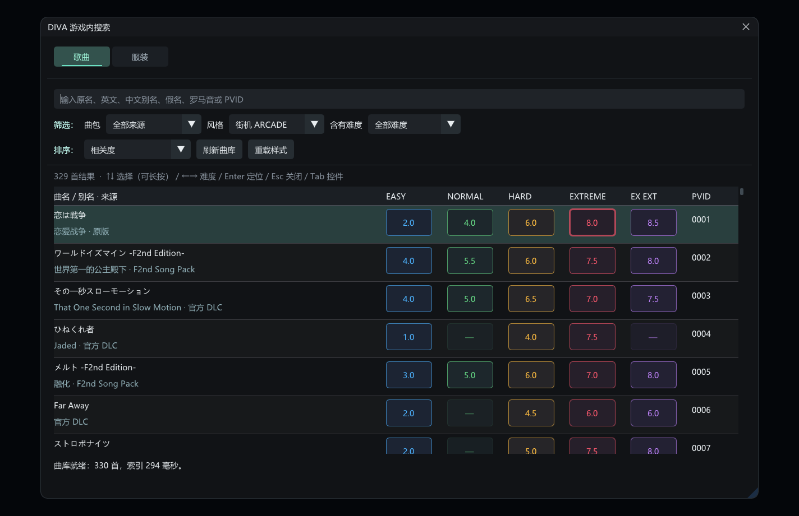

# DIVA 游戏内搜索

在《初音未来 Project DIVA Mega Mix+》中搜索歌曲和服装，默认快捷键 **Ctrl+F**。

**当前版本：1.0.6 · Windows x64 · DivaModLoader 插件**

服装搜索现已支持自动官方／DLC／启用Mod目录、真实图片、名称／英文／假名／别名／ID搜索、角色与来源筛选，以及原生模型列表定位。1.0.6已由用户在实际游戏中确认定位可用；歌曲搜索保留。完整分类、槽位和设置范围仍需继续回归。

这是一个 **Vibe Coding 项目**：通过人与 AI 编程助手协作完成研究、实现与迭代，并通过实际游戏测试核对歌曲和难度定位。欢迎反馈、审阅代码和改进兼容性；版本号不代表所有游戏构建与 Mod 组合都已验证。



## 下载与安装

从 [Releases](https://github.com/HYDlink/DivaInGameSearch/releases/latest) 下载 `DivaInGameSearch-1.0.6-win64.zip`。

1. 安装并配置 [DivaModLoader](https://github.com/blueskythlikesclouds/DivaModLoader)。
2. 退出游戏，将压缩包中的 `DivaInGameSearch` 文件夹放入游戏的 `mods` 目录。
3. 使用 Mod 管理器启用本 Mod。如果手动维护 DML 的 `priority` 数组，将 `DivaInGameSearch` 加入数组；保持现有曲包顺序。
4. 启动游戏，进入普通歌曲选择界面，按 **Ctrl+F** 打开搜索。

运行时不需要 Python、浏览器、联网服务或额外常驻程序。搜索框直接绘制在游戏中；无需进入收藏或 PV 播放列表。

## 怎么使用

- 输入曲名、英文、已配置的中文别名、假名、罗马音或 PVID；切换到 **Mod** 可以按曲包名称检索。
- **筛选：** 按曲包、谱面风格、是否具有某个难度缩小结果。“全部难度”可取消难度筛选。
- **定位：** 选择点击曲名或按 Enter 时使用的目标难度。这里必须有一个具体难度，不能清空；选下拉项本身不会立即定位。
- **排序：** 改变搜索结果顺序，与游戏当前高亮和定位难度相互独立。
- 点击右侧的彩色等级按钮，直接定位到该歌曲的对应难度，无视“定位”下拉框。没有生效谱面的按钮不可点击，不自动降级。
- 搜索框内 **↑↓** 选择歌曲，长按连续快速移动；**←→** 选择当前歌曲的可用难度，跳过缺失谱面，到边界停止。换曲保留目标难度，不自动降级；当前难度没有谱面时，用左右键另选。
- **Enter** 定位，**Esc** 关闭。每次打开面板时，定位难度和风格会同步游戏当前选择。当前歌曲的目标难度用加粗边框标识。
- **Tab / Shift+Tab** 在搜索框、筛选、定位难度、排序及工具间移动；控件获得焦点后，用方向键、Enter 或空格操作。无需鼠标即可完成搜索和筛选。
- 连续输入采用 **150 毫秒防抖和后台检索**，输入法组词期间暂停检索。Enter 会跳过防抖，等最新结果完成后定位，不提交旧查询结果。

定位会核对实际歌曲、难度与风格；不会自动开始演奏。搜索定位可能将游戏的当前分组切换为“全部”，以便显示目标。

## 服装搜索

进入游戏原生模型／服装列表后按 Ctrl+F，面板默认切到服装搜索。输入名称、英文、平片假名、别名或ID；可按角色、来源和顺序筛选。单击卡片、按Enter或点定位按钮提交定位，方向键浏览结果。预览样式、刷新和按键说明位于“选项”。

正常使用自动读取游戏与启用Mod资源，不需要手工导出、Python或.NET。安装时保留压缩包内的三个DLL。目录数量不代表已解锁数量；定位只改变原生列表高亮，不自动装备、购买、保存或演奏。

当前需要已进入模型列表；从换装父菜单自动进入模型、饰品原生定位和任意页面跳回选曲尚未实现。更多角色／槽位／设置范围及不同构建不承诺全面覆盖。已知验证和后续研究见[项目状态](docs/STATUS.md)与[当前运行时交接](docs/research/CURRENT_RUNTIME_HANDOFF.md)。

## 功能与边界

支持原版、官方 DLC 及 Mod 元数据合并，按 DML 配置解析曲包来源；支持 New Classics 谱面风格的数据适配。开启的曲包或数据库发生变化后，需要重启游戏才能继续定位，避免磁盘曲库与游戏已加载内容不一致。

1.0.0 已在实际游戏中确认歌曲定位、同曲切换难度、换曲同时切换难度，包括 EX EXT。当前定位实测以街机风格为主；其他风格、Eden、大量 Mod 组合、不同 DPI 与输入法仍需要更多回归。

已观察到快速定位后封面或作者信息可能暂时保留上一首内容，预览同步仍需改进；不要据此将原生菜单高亮与预览显示视为同一字段。1.0.6已提供服装搜索与原生定位，用户已确认实际定位可用；发型、饰品原生定位与原版收藏接入尚未提供。旧开发版的独立收藏入口已经移除。

本插件包含对特定 PC 游戏构建的适配检查，不承诺任意版本通用。检查不通过时会拒绝定位并显示说明。遇到问题可在 [Issues](https://github.com/HYDlink/DivaInGameSearch/issues) 提供复现步骤及必要的诊断片段；分享日志前请移除不想公开的本机路径。

若搜索关闭后游戏按键失效，请参照 [输入排错与日志收集](docs/INPUT_TROUBLESHOOTING.md)。`search-diagnostics.log` 使用追加写入，正常重启游戏不会覆盖；建议故障后先复制一份，并提供发生时间、输入法、关闭方式和相关 Mod。

## 配置、更新与卸载

配置位于 `mods/DivaInGameSearch`：

| 文件 | 用途 |
| --- | --- |
| `settings.ini` | 快捷键、字号、行高、透明度和成功后是否关闭 |
| `aliases.toml` | 按逻辑 PVID 添加别名，多个别名用竖线分隔；刷新曲库后生效 |
| `customization_catalog.toml`（兼容导入，可选） | 本地服装／饰品导入清单；不是 DML 标准或游戏存档 |
| `search-diagnostics.log` | 初始化、状态检查与定位结果；排错时使用 |

默认快捷键为 Ctrl+F；如与其他 Mod 冲突，修改 `shortcut_vk` 为其他 Win32 虚拟键值。Ctrl+G/L/S 为已有兼容性保护保留，配置这些键会回退到 Ctrl+F。

更新前退出游戏并备份本 Mod 文件夹。替换发行文件时保留自己的 `settings.ini` 和 `aliases.toml`。卸载只需在退出游戏后禁用或移除本 Mod。旧 `favorites.txt` 不属于游戏收藏或云存档，可自行备份。

## Roadmap · 后续支持计划

当前开发树已加入「歌曲／服装／饰品」模式。服装和饰品支持名称／关联 Mod 搜索、角色和来源过滤、饰品部位、稳定排序，以及纵向格子与键盘浏览；角色读取尚未接线时默认初音未来，饰品会包含共通 ALL 项。Tab 进入格子后可用方向键、Home/End 和 PageUp/PageDown；文本框左右键仍编辑文字。Enter 只打开详情，**原生定位、装备和模型预览尚未接入**。

服装／饰品目前只搜索用户明确导入的元数据，未导入时显示空库说明，不附带虚构的游戏物品。支持本插件版本化清单和已解包实体文本表；FARC／CPK 尚不自动解包，图片先显示占位。操作见 [导入说明](docs/CUSTOMIZATION_IMPORT.md)，公开源码研究、Future Tone Customization 缩略图路线和本机内存采集清单见 [实施计划](docs/CUSTOMIZATION_SEARCH_PLAN.md)。

- [x] 游戏内歌曲搜索，定位歌曲与指定难度。
- [ ] **人物模型／服装搜索**：按人物、名称、别名与来源查找 Module，并定位到原生服装列表中的对应项。
- [ ] **发型搜索**：检索当前人物可用发型，并处理服装绑定与适用范围。
- [ ] **饰品搜索**：按人物、部位、名称与来源查找饰品，定位到原生定制菜单。
- [ ] 完善预览资源同步、New Classics 风格与输入法／显示兼容性。

原生服装／饰品定位及发型搜索仍属于后续计划，**已发布的 1.0.0 尚不支持这些新增基础浏览功能**。定位需要分别验证原生菜单的高亮、预览与确认流程；不默认代替玩家确认装备或写入存档。研究方向见 [服装与定制物品研究](docs/research/MODULE_SEARCH_FEASIBILITY.md)。

## 构建与参与开发

需要 Windows x64、PowerShell 7、Visual Studio C++ 工具集、Windows SDK 和 CMake 3.24+。依赖源码随仓库提供，无需下载阅读参考仓库。

```powershell
git clone https://github.com/HYDlink/DivaInGameSearch.git
cd DivaInGameSearch
./scripts/build.ps1
./scripts/verify.ps1 -GameDirectory '你的游戏安装目录'
./scripts/check-profile.ps1 -GameDirectory '你的游戏安装目录'
./scripts/package.ps1
```

构建输出在 `build/release`，发行包在 `artifacts/release`。可选 `SearchPreview.exe` 与 DLL 共用界面源码，方便游戏外检查布局；它不会操作游戏，预览通过不等于游戏内测试通过。

开发者和 AI Agent 可从 [AGENTS.md](AGENTS.md) 开始，再读 [开发指南](docs/IMPLEMENTATION_HANDOFF.md)、[定位流程研究](docs/research/NATIVE_SELECTION_METHODS.md) 和 [验收记录](docs/ACCEPTANCE.md)。原始本机日志、部署备份及临时资料不纳入公开仓库。

游戏内截图与可见行为验收可复用 [Project DIVA 截图指南](docs/GAME_SCREENSHOT_GUIDE.md)，其中包含 BitBlt／PrintWindow 的调用方式、交互桌面权限和图片有效性检查；工具源码位于 tests/native_capture.cpp。

## 参考项目与致谢

本项目建立在社区公开研究之上，特别感谢以下两个重点参考项目：

- **[QuantumSwitch（量子开关）](https://github.com/Snapmali/QuantumSwitch)**：提供 PC 选曲状态、PVID 定位协议、菜单切换与选曲恢复的研究参考，也启发了歌曲数据解析与检索组织。它是菜单生命周期定位路线的重要来源。感谢作者及其致谢的 **hiki8man（Select Song with PVID）**、**[sasnchis（DivaSongViewer）](https://github.com/sasnchis/DivaSongViewer)**。
- **[MikuMikuSwitchPlugin](https://github.com/lsmsmx/MikuMikuSwitchPlugin)**：`SongQuickJump` 提供游戏内搜索与当前界面直接重建列表、刷新筛选的流程参考，启发了正式采用的原位定位路线。PC 适配重新核对对象布局和函数，未直接套用 Switch 地址。感谢作者公开实现与研究成果。

同时感谢 **[NewClassics](https://github.com/mrcloverthecoder/nc)** 提供 PC 选曲对象、列表函数及风格筛选的源码依据，**[DivaModLoader](https://github.com/blueskythlikesclouds/DivaModLoader)** 提供插件加载与数据库规则，以及 **[ReDIVA](https://github.com/korenkonder/ReDIVA)** 提供数据结构和后续服装研究资料。

界面与工程使用 [Dear ImGui](https://github.com/ocornut/imgui)、[Microsoft Detours](https://github.com/microsoft/Detours) 和 [toml++](https://github.com/marzer/tomlplusplus)。所有参考的用途、固定提交与许可说明见 [技术资料来源](docs/SOURCES.md)、[第三方声明](THIRD_PARTY_NOTICES.md) 和 [依赖锁定](docs/DEPENDENCY_LOCK.md)。不把社区逆向成果声称为本项目原创。

## 许可证

项目代码以 **AGPL-3.0-or-later** 发布，详见 [LICENSE](LICENSE)。第三方组件保留各自许可证。游戏名称、歌曲元数据及相关内容权利属于原权利人；本项目不是官方产品。
