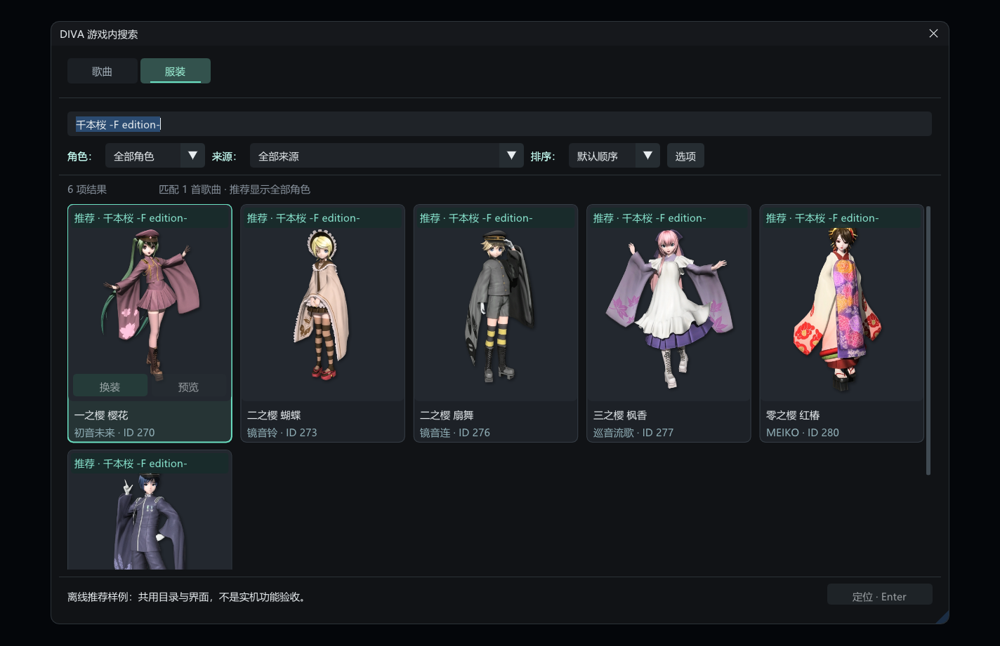

# DIVA 游戏内搜索

在《初音未来 Project DIVA Mega Mix+》中直接搜索歌曲和服装，默认快捷键 **Ctrl+F**。

**当前版本：1.0.11 · Windows x64 · DivaModLoader 插件**

- **歌曲搜索与跳转**：支持原名、英文、中文别名、假名、罗马音和 PVID；双击歌曲名称或点击难度按钮，直接跳转并定位对应歌曲与难度。
- **按歌曲找推荐服装**：在服装页直接输入歌曲名称，显示这首歌推荐的服装；沿用歌曲搜索的匹配方式，同一首歌的多角色推荐一起显示，无须另行导出数据。
- **服装搜索、预览与换装**：自动读取官方、DLC 和已启用 Mod，显示真实图片，支持角色与来源筛选、双击定位、原生模型预览和已拥有服装换装。

歌曲与服装搜索已由用户在实际游戏中测试确认。具体自动回归、用户确认及尚未覆盖的场景见[验收记录](docs/ACCEPTANCE.md)。本项目通过人与 AI 协作开发，欢迎反馈与参与改进。

## 下载与安装

从 [Releases](https://github.com/HYDlink/DivaInGameSearch/releases/latest) 下载 `DivaInGameSearch-1.0.11-win64.zip`。

1. 安装并配置 [DivaModLoader](https://github.com/blueskythlikesclouds/DivaModLoader)。
2. 退出游戏，将压缩包中的 `DivaInGameSearch` 文件夹放入游戏的 `mods` 目录。
3. 使用 Mod 管理器启用本 Mod；手动配置时将 `DivaInGameSearch` 加入 DML 的 `priority`，保持原有曲包加载顺序。
4. 启动游戏，按 **Ctrl+F** 打开搜索，选择“歌曲”或“服装”。

运行时不需要 Python、.NET、浏览器、联网服务、额外常驻程序或手工导出资源。请保留包内三个 DLL。`SearchPreview.exe` 是可选的游戏外界面预览工具。

## 歌曲搜索


- 输入歌曲原名、英文、中文别名、假名、罗马音或 PVID。通过曲包、谱面风格和含有难度筛选，选择结果排序。
- **双击同一歌曲名称**，或**单击结果里的难度按钮**，从已支持的主页／自定义列表进入选曲页并定位。不会自动开始演奏。
- 已在选曲页时，单击名称或 **Enter** 原位定位；名称单击和 Enter 不会跨页。
- 搜索框内 **↑↓** 选择结果，**←→** 选择当前歌曲的可用难度；缺失谱面不自动降级。每次打开时同步游戏当前难度与风格，目标难度用加粗边框标识。
- **Tab / Shift+Tab** 切换控件，**Esc** 或点击窗口外部关闭搜索。
- 连续输入采用 **300 毫秒防抖和后台检索**，输入法组词期间暂停查询；Enter 等待最新结果后定位，不提交旧结果。

定位会独立核对实际 PVID、难度和风格。为显示目标，游戏当前歌曲分组可能切换为“全部”。主机风格没有 EX EXT 的歌曲会如实显示不可用。

## 按歌曲搜索推荐服装

**直接在服装搜索框输入歌曲名称，就能找到该歌曲推荐的服装。** 不需要切换检索模式，也不必先切到这首歌或额外导出推荐表。

歌曲匹配复用歌曲页的原名、英文、中文别名、假名、罗马音、PVID及相关度排序。推荐关系从游戏已加载的 PVDB 读取，以人物和推荐服装编号映射当前有效模型目录；多首歌、多位演出角色合并去重，卡片标明推荐歌曲。搜索本身不会切歌。



以上两张图由与游戏共用的原生界面生成。服装图使用已采样的《千本樱》推荐值与实际服装目录展示布局；截图本身不作为游戏内操作验收证据。

## 服装搜索、预览与换装

- 输入服装名称、英文、假名、别名、ID 或歌曲名称；使用 **角色：／来源：／排序：** 调整结果。首次默认全部角色，重开与搜索保留自己的选择。
- **双击同一服装卡片主体**，从已支持页面进入模型页并定位；已在模型页时，也可单击、Enter 或底部定位按钮原位定位。双击不包括卡片上的动作按钮。
- 在模型页悬停卡片，点击 **预览** 打开原生模型预览，点击 **换装** 装备当前槽位可用且已拥有的服装；受理后隐藏搜索窗口。
- 可以直接操作其他人物分类的服装，按原生流程准备目标分类；预览结束后保留原浏览分类与高亮，核对原装备恢复。
- 预览中重新打开搜索，可继续选择定位、另一件服装预览、换装或歌曲跳转；先安全退出旧预览，再执行新操作。
- 服装名称优先跟随游戏当前语言，Mod 提供的对应语言名称按实际来源优先级生效；缺失翻译时保留提供者原名，不生成虚构译名。
- “选项”中保留图片样式、刷新与按键说明。未完成的饰品与开发用性能监测入口不对玩家显示。

普通定位仅改变列表高亮，不购买或装备；只有明确点击“换装”才提交装备操作。目录中出现一件服装不等于玩家已拥有。动作保留拥有、槽位、设置范围和实际装备读回检查，不使用购买命令。

## 兼容性与已知边界

支持原版、官方 DLC、已启用 Mod 及 New Classics 谱面风格。曲包或数据库变化后应重启游戏，避免磁盘目录与游戏已加载内容不同。

原生服装动作目前针对已认证的单曲设置范围与普通服装。发型、饰品原生动作和特殊泳装推荐继承仍未提供完整支持；缺失或有歧义的推荐会明确提示。不同游戏构建、槽位、风格及 Mod 组合不能视为全部覆盖。

歌曲定位后封面或作者信息偶尔可能短暂保留上一首内容。输入延迟问题尚未取得完整自然输入对照，不能宣称所有输入法卡顿已解决。遇到问题请到 [Issues](https://github.com/HYDlink/DivaInGameSearch/issues) 提供复现步骤，输入问题可参考[排错指南](docs/INPUT_TROUBLESHOOTING.md)。分享诊断前请移除不想公开的本机路径。

## 配置、更新与卸载

| 文件 | 用途 |
| --- | --- |
| `settings.ini` | 快捷键、字号、行高、透明度和成功后是否关闭 |
| `aliases.toml` | 歌曲中文别名等扩展名称，修改后刷新曲库 |
| `customization_catalog.toml`（可选兼容导入） | 本地服装／饰品清单，正常使用不需要 |
| `search-diagnostics.log` | 初始化、状态检查与定位诊断 |

默认 **Ctrl+F**。需要时在 `settings.ini` 修改 `shortcut_vk`；Ctrl+G/L/S 为已有兼容性保护保留，配置这些值会回退为 Ctrl+F。

更新前退出游戏并备份本 Mod，替换文件时保留自己的 `settings.ini`、`aliases.toml`。卸载时在游戏退出后禁用或移除本 Mod；不需要更改游戏存档或其他 Mod。旧 `favorites.txt` 不属于原生游戏收藏或云存档。

后续计划包括发型与饰品原生动作、更完整的设置范围、特殊推荐规则及兼容性覆盖。

## 构建与参与开发

需要 Windows x64、PowerShell 7、Visual Studio C++ 工具集、Windows SDK 和 CMake 3.24+。依赖源码随仓库提供，无需下载阅读参考仓库。

```powershell
git clone https://github.com/HYDlink/DivaInGameSearch.git
cd DivaInGameSearch
./scripts/build.ps1
./scripts/verify.ps1 -GameDirectory '你的游戏安装目录'
./scripts/check-profile.ps1 -GameDirectory '你的游戏安装目录'
./scripts/package.ps1
```

构建输出在 `build/release`，发行包在 `artifacts/release`。可选 `SearchPreview.exe` 与 DLL 共用界面源码，方便游戏外检查布局；它不会操作游戏，预览通过不等于游戏内测试通过。

开发者和 AI Agent 可从 [AGENTS.md](AGENTS.md) 开始，再读 [开发指南](docs/IMPLEMENTATION_HANDOFF.md)、[定位流程研究](docs/research/NATIVE_SELECTION_METHODS.md) 和 [验收记录](docs/ACCEPTANCE.md)。原始本机日志、部署备份及临时资料不纳入公开仓库。

游戏内截图与可见行为验收可复用 [Project DIVA 截图指南](docs/GAME_SCREENSHOT_GUIDE.md)，其中包含 BitBlt／PrintWindow 的调用方式、交互桌面权限和图片有效性检查；工具源码位于 tests/native_capture.cpp。

## 参考项目与致谢

本项目建立在社区公开研究之上，特别感谢以下两个重点参考项目：

- **[QuantumSwitch（量子开关）](https://github.com/Snapmali/QuantumSwitch)**：提供 PC 选曲状态、PVID 定位协议、菜单切换与选曲恢复的研究参考，也启发了歌曲数据解析与检索组织。它是菜单生命周期定位路线的重要来源。感谢作者及其致谢的 **hiki8man（Select Song with PVID）**、**[sasnchis（DivaSongViewer）](https://github.com/sasnchis/DivaSongViewer)**。
- **[MikuMikuSwitchPlugin](https://github.com/lsmsmx/MikuMikuSwitchPlugin)**：`SongQuickJump` 提供游戏内搜索与当前界面直接重建列表、刷新筛选的流程参考，启发了正式采用的原位定位路线。PC 适配重新核对对象布局和函数，未直接套用 Switch 地址。感谢作者公开实现与研究成果。

同时感谢 **[NewClassics](https://github.com/mrcloverthecoder/nc)** 提供 PC 选曲对象、列表函数及风格筛选的源码依据，**[DivaModLoader](https://github.com/blueskythlikesclouds/DivaModLoader)** 提供插件加载与数据库规则，以及 **[ReDIVA](https://github.com/korenkonder/ReDIVA)** 提供数据结构和后续服装研究资料。

界面与工程使用 [Dear ImGui](https://github.com/ocornut/imgui)、[Microsoft Detours](https://github.com/microsoft/Detours) 和 [toml++](https://github.com/marzer/tomlplusplus)。所有参考的用途、固定提交与许可说明见 [技术资料来源](docs/SOURCES.md)、[第三方声明](THIRD_PARTY_NOTICES.md) 和 [依赖锁定](docs/DEPENDENCY_LOCK.md)。不把社区逆向成果声称为本项目原创。

## 许可证

项目代码以 **AGPL-3.0-or-later** 发布，详见 [LICENSE](LICENSE)。第三方组件保留各自许可证。游戏名称、歌曲元数据及相关内容权利属于原权利人；本项目不是官方产品。
